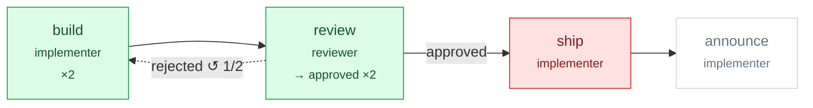

# Flow run: code-review

❌ **failed** · started 2026-10-29 10:00:00 UTC · 95s · 8.7k tokens · $0.0423 of $1.00

> Step 'ship' failed: step limit reached.

## Task

````text
Add pagination to the orders API.
Keep the page size configurable.
````

## Flow



## Steps

| Step | Round | Character | Model | State | Outcome | Tokens | Cost | Duration |
|---|---|---|---|---|---|---|---|---|
| `build` | 1 | bob | openai/gpt-4o | done |  | 1.5k | $0.01 | 10s |
| `review` | 1 | rae | openai/gpt-4o | done | rejected | 2.3k | $0.0123 | 12s |
| `build` | 2 | bob | openai/gpt-4o | done |  | 2.2k | $0.015 | 20s |
| `review` | 2 | rae | openai/gpt-4o | done | approved | 2.7k | $0.005 | 14s |
| `ship` | 1 |  |  | failed |  |  |  | 3s |

## Results

<details><summary><b>build</b></summary>

Pagination added.

</details>

<details><summary><b>review</b> — approved</summary>

Looks good now.

</details>

<details><summary><b>ship</b> (failed)</summary>

_step limit reached_

</details>

## Totals

- Steps run: 5
- Tokens: 7k in / 1.7k out
- Cost: $0.0423
- Wall-clock time: 95s

## Changed files

- `src/Orders.cs` — build
- `src/OrdersTests.cs` — build

<sub>Run `20261029-100000-abc123`</sub>
